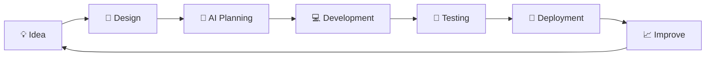

<!-- ========================= HERO ========================= -->

<div align="center">


<br/>


<br/><br/>

<a href="https://webdevmehedi.com/">

</a>

<a href="mailto:ailshourov2@gmail.com">

</a>

<a href="https://github.com/web-dev-mehedi">

</a>

<br/><br/>


</div>

---

<!-- ========================= ABOUT ========================= -->

<div align="center">

## ⚡ WHO AM I?


</div>

<br/>

<table align="center">
<tr>
<td width="50%">

### 👨‍💻 About Me

```yaml
Name: Mehedi
Role: Full-Stack Developer

Focus:
  - AI Applications
  - Web Development
  - Developer Tools
  - Desktop Apps
  - Automation

Currently:
  - Building AI Products
  - Learning Laravel
  - Exploring AI Agents
```

</td>

<td width="50%">

### 🚀 Current Mission

```text
IDEA
 ↓
DESIGN
 ↓
DEVELOPMENT
 ↓
AI
 ↓
AUTOMATION
 ↓
REAL PRODUCT
```

> Turning ambitious ideas into
> useful software people can actually use.

</td>
</tr>
</table>

---

<!-- ========================= CURRENTLY BUILDING ========================= -->

<div align="center">

## 🔥 CURRENTLY BUILDING


### 🧠 AI Powered PRD Generator

**Turn a simple idea into a structured, development-ready Product Requirement Document.**

<a href="https://webdevmehedi.com/">

</a>

<br/><br/>


</div>

---

<!-- ========================= TECH STACK ========================= -->

<div align="center">

## 🛠️ MY ARSENAL

### 💻 Languages


<br/><br/>

### 🎨 Frontend


<br/><br/>

### ⚙️ Backend


<br/><br/>

### 📱 Mobile & Desktop


<br/><br/>

### 🗄️ Database & Cloud


<br/><br/>

### 🧰 Tools


</div>

---

<!-- ========================= SKILL BARS ========================= -->

## 📊 Development Focus

```text
Frontend Engineering     ███████████████████░  95%
Backend Development      █████████████████░░░  85%
AI Integration           ████████████████░░░░  80%
UI / UX                  █████████████████░░░  85%
Desktop Applications     ███████████████░░░░░  75%
Mobile Development       ██████████████░░░░░░  70%
Cloud & DevOps            █████████████░░░░░░░  65%
```

---

<!-- ========================= PROJECTS ========================= -->

<div align="center">

## 🚀 FEATURED PROJECTS

</div>

<table>
<tr>

<td width="50%" align="center">

### 🧠 AI PRD Generator

AI-powered product development platform.

**AI • TypeScript • Web**

<a href="https://webdevmehedi.com/">

</a>

</td>

<td width="50%" align="center">

### 🎙️ Multi-Language Voice Typing

Next-generation voice typing for desktop.

**AI • Speech • Desktop**


</td>

</tr>

<tr>

<td width="50%" align="center">

### 🌐 Modern Web Apps

High-performance websites and applications.

**React • Next.js • Node.js**

</td>

<td width="50%" align="center">

### 🤖 AI Developer Tools

Automation tools designed to make developers faster.

**AI • APIs • Automation**

</td>

</tr>
</table>

---

<!-- ========================= GITHUB STATS ========================= -->

<div align="center">

## 📈 GITHUB ANALYTICS

<br/>


<br/><br/>


</div>

---

<!-- ========================= ACTIVITY ========================= -->

<div align="center">

## ⚡ GITHUB ACTIVITY


</div>

---

<!-- ========================= SNAKE ========================= -->

<div align="center">

## 🐍 CONTRIBUTION JOURNEY


</div>

---

<!-- ========================= CURRENTLY LEARNING ========================= -->

<div align="center">

## 🌱 CURRENTLY LEARNING


</div>

---

<!-- ========================= WORKFLOW ========================= -->

## ⚙️ How I Build



---

<!-- ========================= GOALS ========================= -->

<div align="center">

## 🎯 2026 MISSION

</div>

| Goal                                | Status      |
| ----------------------------------- | ----------- |
| 🤖 Build AI-powered products        | 🔥 Active   |
| 🧠 Master Laravel                   | 🟡 Learning |
| 🎙️ Build multilingual voice typing | 🔥 Active   |
| ⚡ Build AI developer tools          | 🔥 Active   |
| 🌍 Contribute to Open Source        | 🟡 Growing  |
| 🚀 Launch real-world products       | 🔥 Always   |

---

<!-- ========================= COLLABORATION ========================= -->

<div align="center">

## 🤝 LET'S BUILD TOGETHER

**I'm interested in collaborating on innovative projects involving**


<br/><br/>

### 💬 Have an interesting idea?

**Let's turn it into something real. 🚀**

</div>

---

<!-- ========================= SOCIAL ========================= -->

<div align="center">

## 🌐 CONNECT WITH ME

<br/>

<a href="https://linkedin.com/in/webdevmehedi">

</a>

<a href="https://twitter.com/webdevmehedi">

</a>

<a href="https://fb.com/webdevmehedi">

</a>

<a href="https://www.instagram.com/web-dev-mehedi">

</a>

<a href="https://www.youtube.com/c/webdevmehedi">

</a>

<br/><br/>

<a href="mailto:ailshourov2@gmail.com">

</a>

</div>

---

<div align="center">


### ⚡ BUILD. BREAK. LEARN. REPEAT.

**Thanks for visiting my profile! ⭐**

</div>
